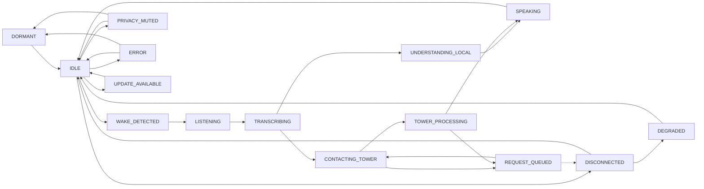

# ARCHITECTURE DIAGRAM (Mermaid) — HERMES VOICE CONSOLE ANDROID

| | |
|---|---|
| Owner | Paolo Lombisani |
| Version | v0.1.0-alpha |
| Date | 2026-10-30 |
| Rendering | GitHub/GitLab render this natively; `mmdc -i docs/ARCHITECTURE_DIAGRAM.md` also renders it |

## 1. Component diagram — layers and seams

```mermaid
flowchart TB
    subgraph UI["UI Layer - Jetpack Compose"]
        CONSOLE["S1 Console Screen<br/>TowerCore animation"]
        S2["S2 History"]
        S3["S3 Connection"]
        S4["S4 Voice and Audio"]
        S5["S5 Local Intelligence"]
        S6["S6 Appearance"]
        S7["S7 Diagnostics"]
        S8["S8 About and Safety"]
        NAV["AppNav + HermesTheme"]
    end

    subgraph APPSVC["Application Services"]
        STORE["ConsoleStateStore<br/>single source of truth"]
        DRIVER["ScriptedConsoleDriver<br/>voice-loop orchestration V0.1"]
        SETTINGS["SettingsRepository<br/>SharedPreferences"]
        GRAPH["AppGraph<br/>service locator"]
    end

    subgraph DOMAIN["Domain - pure Kotlin, zero Android imports"]
        SM["ConsoleStateMachine<br/>15 states, legal transitions"]
        ROUTER["IntentRouter<br/>RuleBasedIntentRouter"]
        SESSION["SessionController"]
        EVENTS["LocalEventStore"]
        CONTRACT["TowerContract models<br/>hermes.console.v0.1"]
        REDACT["LogRedactor"]
        INTERFACES["Engine contracts:<br/>WakeWordEngine - VoiceActivityDetector - AudioCaptureEngine<br/>SpeechToTextEngine - LocalConversationEngine - TextToSpeechEngine<br/>TowerBridge - AnimationStateController - DeviceHealthMonitor<br/>SecureConfigurationStore - DiagnosticsExporter"]
    end

    subgraph ADAPTERS["Adapters - replaceable"]
        MOCKBRIDGE["MockTowerBridge<br/>+ DeterministicTowerSimulator<br/>injectable faults"]
        MOCKLOCAL["MockLocalConversationEngine<br/>canned deterministic"]
        MOCKTTS["MockTextToSpeechEngine<br/>amplitude synthesis"]
        STUBS["Inactive stubs:<br/>wake - VAD - STT - capture"]
        HEALTH["AndroidDeviceHealthMonitor<br/>real Build / RAM / battery data"]
        SVC["VoiceConsoleService skeleton<br/>registered, not started"]
    end

    subgraph FUTURE["Future adapters - V0.3 to V0.6, behind same interfaces"]
        REALSTT["whisper.cpp / system STT"]
        REALTTS["System TTS / Piper"]
        REALBRIDGE["OkHttp WSS adapter<br/>real Hermes Tower"]
        REALLLM["llama.cpp runtime<br/>qualified candidates only"]
    end

    NAV --> CONSOLE & S2 & S3 & S4 & S5 & S6 & S7 & S8
    CONSOLE & S2 & S3 & S4 & S5 & S6 & S7 & S8 --> STORE
    GRAPH --> APPSVC
    STORE --> SM
    DRIVER --> ROUTER
    DRIVER --> STORE
    DRIVER --> INTERFACES
    DRIVER --> SESSION
    DRIVER --> EVENTS
    INTERFACES --> MOCKBRIDGE
    INTERFACES --> MOCKLOCAL
    INTERFACES --> MOCKTTS
    INTERFACES --> STUBS
    INTERFACES --> HEALTH
    MOCKBRIDGE --> CONTRACT
    MOCKBRIDGE -.-> REALBRIDGE
    STUBS -.-> REALSTT
    MOCKTTS -.-> REALTTS
    MOCKLOCAL -.-> REALLLM
    S7 --> HEALTH
    S7 --> EVENTS
    EVENTS --> REDACT
    SETTINGS --> STORE
    SVC -.-> DRIVER
```



## 2. Dependency direction rule

```
UI ──► Application Services ──► Domain ◄── Adapters
```

Adapters implement domain interfaces; nothing in Domain imports Android or an adapter; the UI never touches an adapter. Future adapters plug into the same interfaces (dotted arrows) without UI changes.

## 3. State machine overview



Full authoritative table with all legal edges: UI_STATE_MACHINE.md §3.
