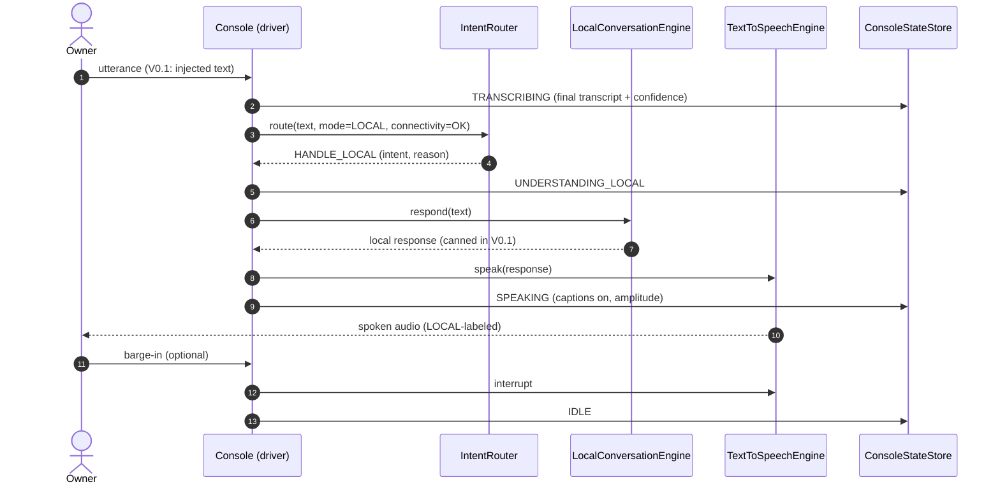
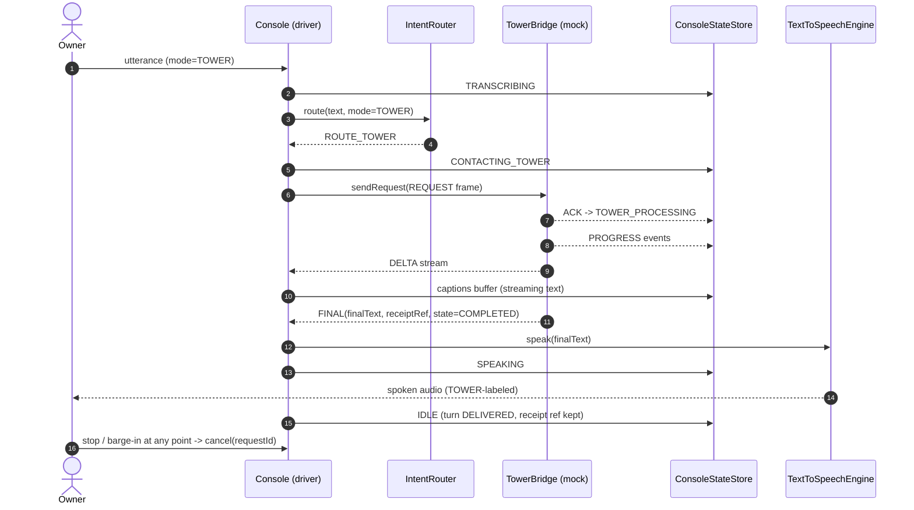
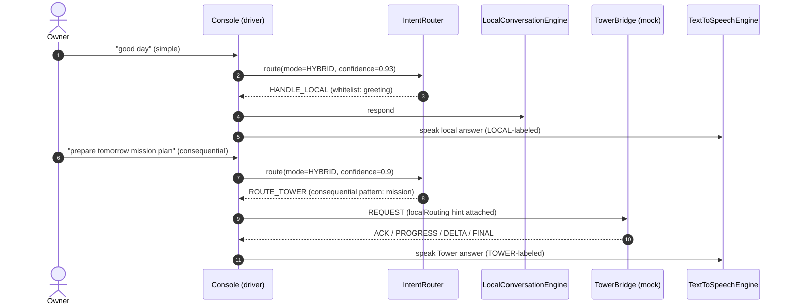
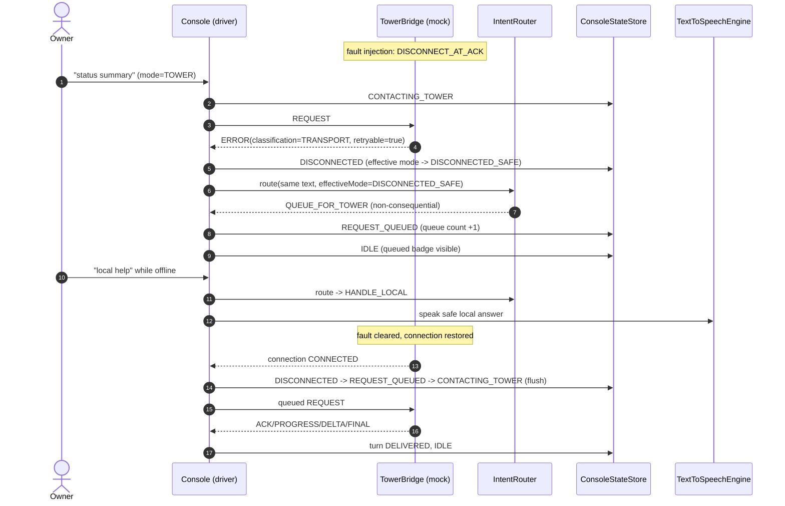
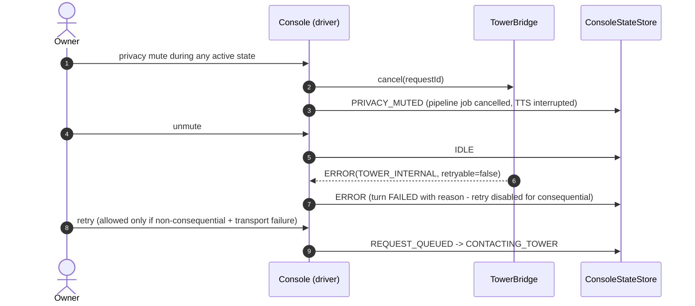

# SEQUENCE DIAGRAMS (Mermaid) — HERMES VOICE CONSOLE ANDROID

| | |
|---|---|
| Owner | Paolo Lombisani |
| Version | v0.1.0-alpha |
| Date | 2026-10-30 |
| Note | V0.1 simulates STT/wake with text injection; the sequence structure is the one the real engines will drive from V0.3. |

## 1. LOCAL — local-only resolution

## 2. TOWER — full forwarding with streaming

## 3. HYBRID — router decides per turn

## 4. DISCONNECTED_SAFE — disclosure, queue, flush

## 5. Failure and cancellation overlay (applies to all modes)

